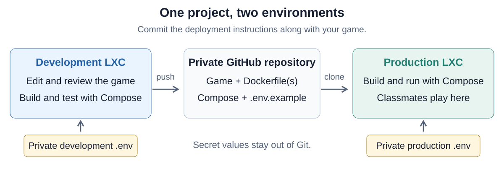
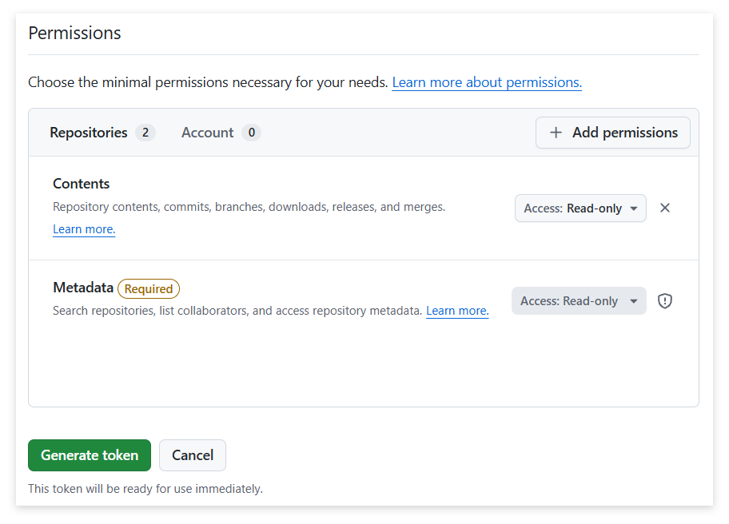
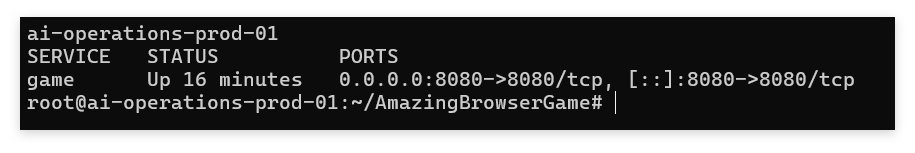
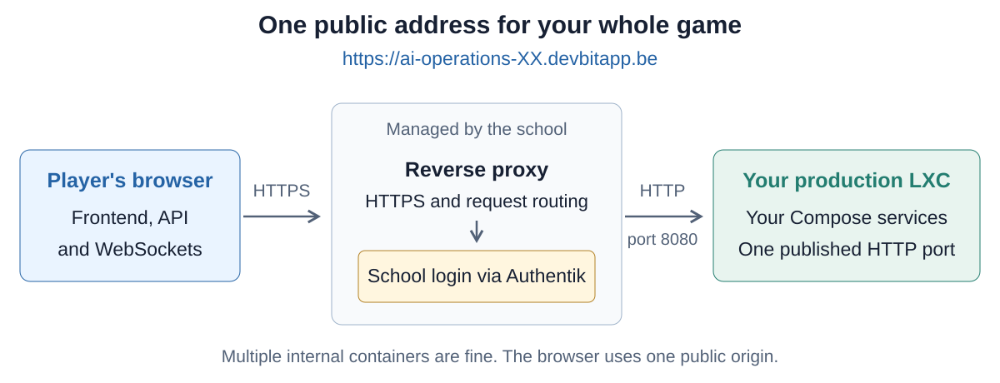
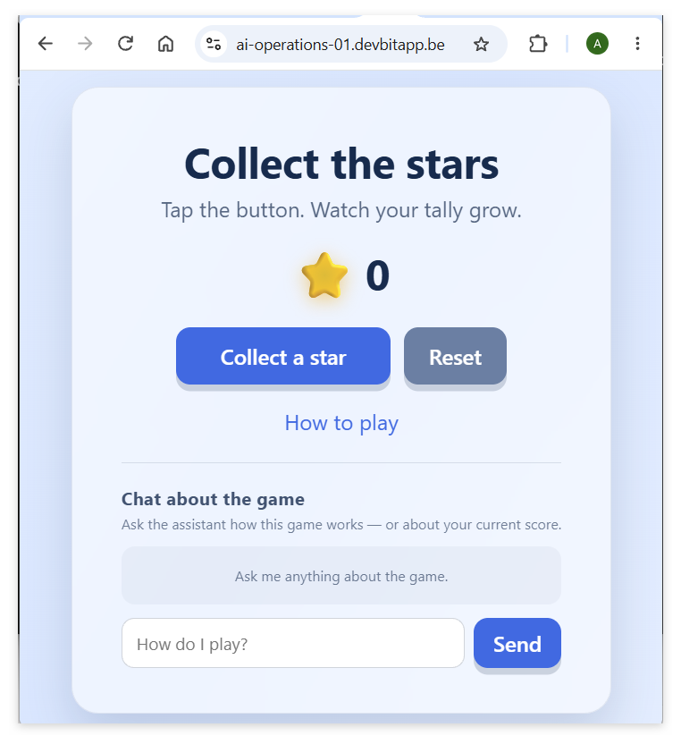

# 12 — Deploy your game


Your game runs on your development server. Now give it a separate home where
classmates can play while you continue developing. You will package the game
with Docker Compose, then deploy it manually to your assigned production server.
The next assignment will automate that deployment with GitHub Actions.

Keep your existing game, language and framework. Work with your coding agent,
but review its choices and try the deployed game yourself.

## From development to production

Your **development server** is where you edit code and experiment. Your
**production server** runs the version you have chosen to share. Restarting a
development process should not interrupt somebody playing the published game.
Both servers are LXC containers supplied by the school. Docker runs inside them
to package and run your application.

A Docker **image** contains your application and its runtime dependencies.
A **container** is an instance of that image. A Dockerfile describes how to
build an image, while **Compose** describes the services, configuration, network
connections and storage needed to run the application together.

[](assets/12-development-to-production.svg)

We will transfer committed source through GitHub and build on each server.
This makes the deployment procedure repeatable without manually copying your
working folder. It does not guarantee identical image builds if dependencies
change, so keep dependency lockfiles where your tools support them.

## Prepare your game for deployment

In your game folder on the **development server**, discuss the deployment
with your coding agent:

> Inspect our game and explain what it needs to run: frontend, backend, external
> APIs, configuration and any stored data. Propose Dockerfile(s) and a
> compose.yaml for a production deployment, keeping our existing technology.
> The whole game must be reachable through one HTTP port, 8080 on the host.
> Explain your plan before implementing it.

Multiple containers are fine. The requirement is **one public entry point**:
the browser must reach the frontend, API and any WebSockets through the same
host and port. Your backend might serve the frontend itself, or a small web
server can serve the frontend and forward API requests internally. Choose what
fits your game. Databases and other internal services do not need published ports.

Browser requests should use the current website's origin where possible, such
as `/api/...`. `localhost` in a player's browser means **that player's computer**,
not your server. Internal Compose service names are also not browser addresses.

Once you agree on the plan, let the agent implement it. Include the frontend
build, backend and game documentation the application actually needs. The
deployment must not depend on a separate development server or a bind mount of
your development source folder. The HTTP service must listen on a reachable
interface inside its container, usually `0.0.0.0`, rather than only `127.0.0.1`.
Ask the agent to explain the host-to-container port mapping. At the end of this
assignment, you will also configure and test automatic startup after a reboot.

## Separate configuration from code

The code can be the same on both servers while configuration differs. Keep
private values in a local **`.env`** beside `compose.yaml`. Commit a
**`.env.example`** containing the required names and harmless example values,
so another deployment can see what it needs. For example:

```dotenv
VIVES_LLM_API_KEY=
```

Use your game's existing variable names. On each server, create its private
file from the example and fill it in yourself. Do not paste keys into agent
chat. Add `.env` to `.gitignore` and exclude it from Docker build contexts with
`.dockerignore`. Make sure `.env.example` can still be committed. Keep the API
key on the backend, never in a frontend bundle.

Compose reads `.env` for substitution. It does **not** automatically pass every
value into every container. Explicitly connect needed values to the service
that uses them, for example in your existing backend service:

```yaml
environment:
  VIVES_LLM_API_KEY: ${VIVES_LLM_API_KEY:?Set VIVES_LLM_API_KEY in .env}
```

This reports a missing value before starting. Environment variables supplied
to the Compose command can provide the same values later in GitHub Actions.
See Docker's [Compose variable guide](https://docs.docker.com/compose/how-tos/environment-variables/variable-interpolation/).

Also decide what should survive a container being replaced. Saved accounts or
scores may need a named [volume](https://docs.docker.com/engine/storage/volumes/)
or a [bind mount](https://docs.docker.com/engine/storage/bind-mounts/) to a stable
directory outside the Git repository. If nothing needs saving, neither is
required. An in-memory match may intentionally reset. Persistent storage preserves
files, not a running process's memory. Do not add a database merely for this assignment.

## Run the containerized game

Still on the **development server**, create and edit your `.env` if you have
not already done so. Run these commands from the folder containing Compose:

```bash
docker compose up -d --build
docker compose ps
docker compose logs --tail=50
```

`--build` builds the images before starting, and `-d` leaves the containers
running in the background. `ps` shows their state, while logs help explain a
failed startup. A running container alone does not prove the game works.
See the [Compose up reference](https://docs.docker.com/reference/cli/docker/compose/up/).

Remember: restarting an existing container does not rebuild its image. After
changing code that is copied into the image, run `docker compose up -d --build`
again to build and deploy the updated version.

On your **laptop**, open `http://YOUR-DEVELOPMENT-SERVER:8080`, using its
Tailscale name/address or reachable campus IP. Try two browser sessions as
separate players. Check shared game state, the AI chat and its document lookup.
Verify that these work without the old development process running.
If your game promises persistent data, also check that it survives replacing
the containers while retaining their volumes.

Fix problems on development with your agent. Review the Dockerfiles, Compose
configuration and ignored files, then commit and push through your existing
GitHub workflow. Confirm that `.env.example` is included and `.env` is not.

## Deploy to your production server

The teacher supplies your production address and password privately. Your
production server is named `ai-operations-prod-XX`, using your existing student
number. Docker and Compose are already installed.

Replace `XX`, `YOUR-PRODUCTION-IP` and the repository details in the examples
with your assigned number, address and game repository. These are not literal
hostnames or commands to copy unchanged.

From your **laptop**, connect through the campus **devbit** network:

```text
ssh root@YOUR-PRODUCTION-IP
```

Check the hostname so you know which server you are changing. Both development
and production currently allow direct campus access. For access from home,
follow [Assignment 03](03-develop-on-a-remote-server.md) to add this new machine
to your own Tailscale network with `tailscale up --ssh`. You can then connect
through its Tailscale name, including with VS Code Remote SSH.

<a href="assets/12-production-token-permissions.png"></a>

On the **production server**, use the GitHub CLI authentication procedure from
[Assignment 04](04-put-your-game-on-github.md#install-github-cli-and-authenticate-on-your-linux-server).
Install `gh` if needed. Create a **separate fine-grained token** restricted to
your game repository, with **Contents: Read-only** and the automatically included
metadata access. Production only needs to clone the code for this assignment.
Follow the same private token-entry procedure and `gh auth setup-git` step.

Clone the repository on **production**:

```text
cd /root
gh repo clone https://github.com/YOUR-USERNAME/YOUR-REPOSITORY.git
cd YOUR-REPOSITORY
git log -1 --oneline
```

Check that the commit is the version you just prepared. Create the production
configuration, keeping any existing `.env` if you are repeating these steps:

```bash
cp -n .env.example .env
chmod 600 .env
vi .env
```

Fill in your actual values privately. You can also use VS Code's editor through
Remote SSH. If your application needs its production website URL, use
`https://ai-operations-XX.devbitapp.be` with your two-digit number.
Then, from this same **production** folder:

```bash
docker compose up -d --build
docker compose ps
docker compose logs --tail=50
```

Keep coding on development and transfer reviewed changes through GitHub.
Production should run that committed version, rather than accumulating its
own uncommitted code fixes.

Check `hostname` to confirm this is production. For a compact service overview,
you can also run:

```bash
docker compose ps --format "table {{.Service}}\t{{.Status}}\t{{.Ports}}"
```

<a href="assets/12-production-compose-status.png"></a>

## Open your game to your classmates

Your public address is **`https://ai-operations-XX.devbitapp.be`**, with your
two-digit number from `01` to `15`. The school has configured HTTPS and
Authentik login. Every student in this class can access every game.

[](assets/12-public-game-access.svg)

The reverse proxy forwards requests to **HTTP port 8080 on your production
server**. Your containers do not need their own public certificates. School
login protects this public route, not direct access to the backend's IP address,
and it does not replace your game's own player/session logic.

<a href="assets/12-public-game.png"></a>

Open the public URL, sign in and ask a classmate to join. Play together and try
the AI features. Browser requests must stay on the public HTTPS origin, including
secure WebSocket connections if your game uses them. Inspect failed requests
in the browser and backend logs with your agent if something breaks.

To narrow down a problem, first run `curl -i http://localhost:8080` in the
**production server's** terminal and inspect `docker compose ps` and the logs.
Then try the public URL in your browser. If the local service responds but the
public route fails, report the URL and error to the teacher. The school manages
the proxy and login configuration. If the page loads
but gameplay fails, inspect the browser's API/WebSocket requests and backend logs.

Close your SSH session and check that the game remains available. To deliberately
stop it later, reconnect and run `docker compose stop` in the production project
folder. Start it again with `docker compose up -d`. Avoid `down -v` unless you
intend to delete the project's Compose-managed volumes.

## Restart and review your deployment

Your game should come back online when its production LXC reboots. On
**development**, add this setting inside each Compose service that should keep
running, such as the web server, backend and database:

```yaml
restart: always
```

Do not apply it to one-off tasks such as database migrations. Docker will restart
these persistent services when they exit and when Docker starts again. A manually
stopped container also returns after Docker restarts. See Docker's
[restart policy documentation](https://docs.docker.com/engine/containers/start-containers-automatically/).

Commit and push the change. In your **production project folder**, apply it:

```bash
git pull --ff-only
docker compose up -d --build
```

Check that the game works, then confirm you are on your assigned **production
LXC**, not development. Enable Docker at boot and reboot that LXC:

```bash
systemctl enable docker
reboot
```

Your SSH connection will close. Wait for the server to return, then open your
public game URL **without manually starting Compose**. Play again and check any
data you expected to persist. If it does not recover, reconnect and inspect
`systemctl status docker`, `docker compose ps` and the application logs.

With your agent, record the build/start commands, required configuration names
and persistence choices in your project's README. Keep secret values out.
Update the project memory with what now works and what should happen next.

You should be able to explain what runs on each machine, how a browser reaches
your game, and what happens to configuration and data when containers are
replaced. You now have a manual deployment to automate in the next assignment.
