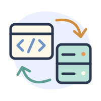
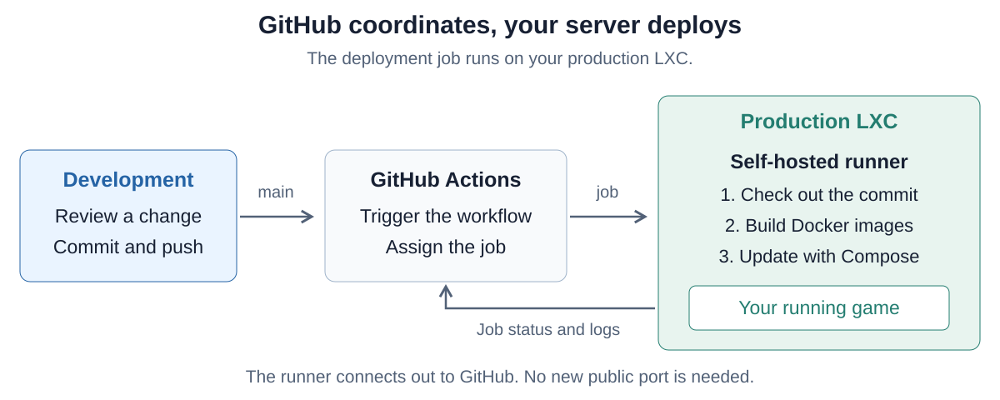
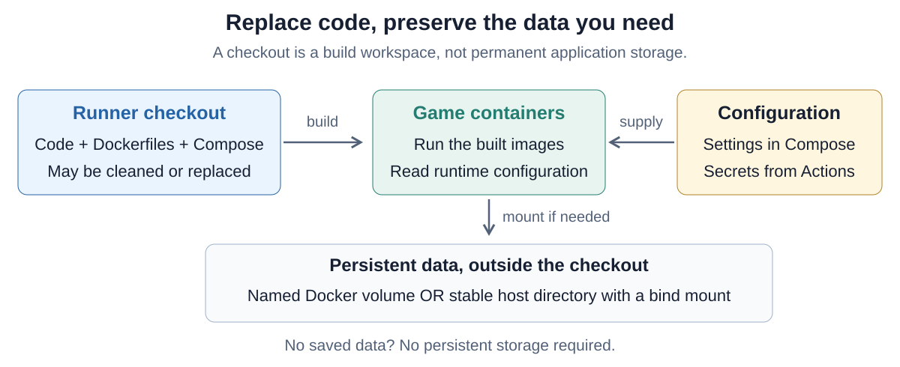
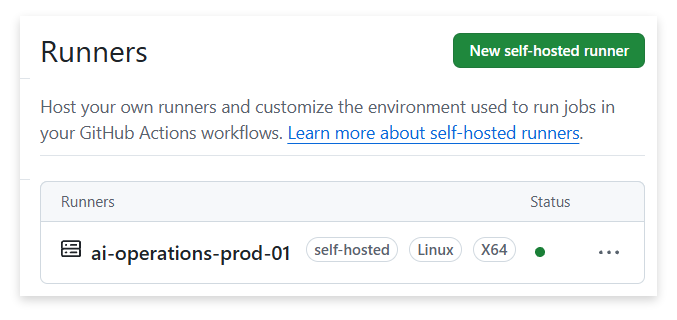
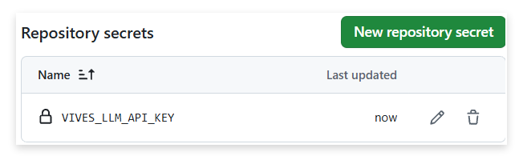
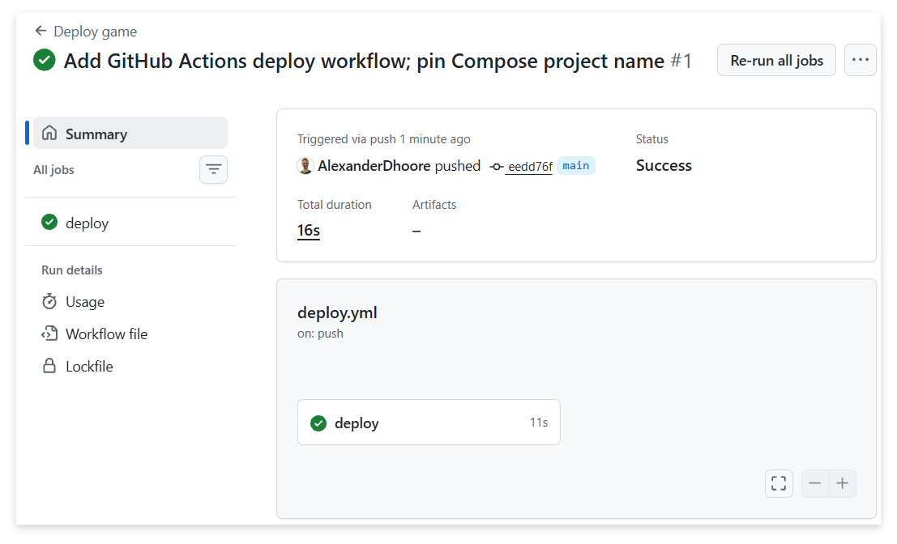
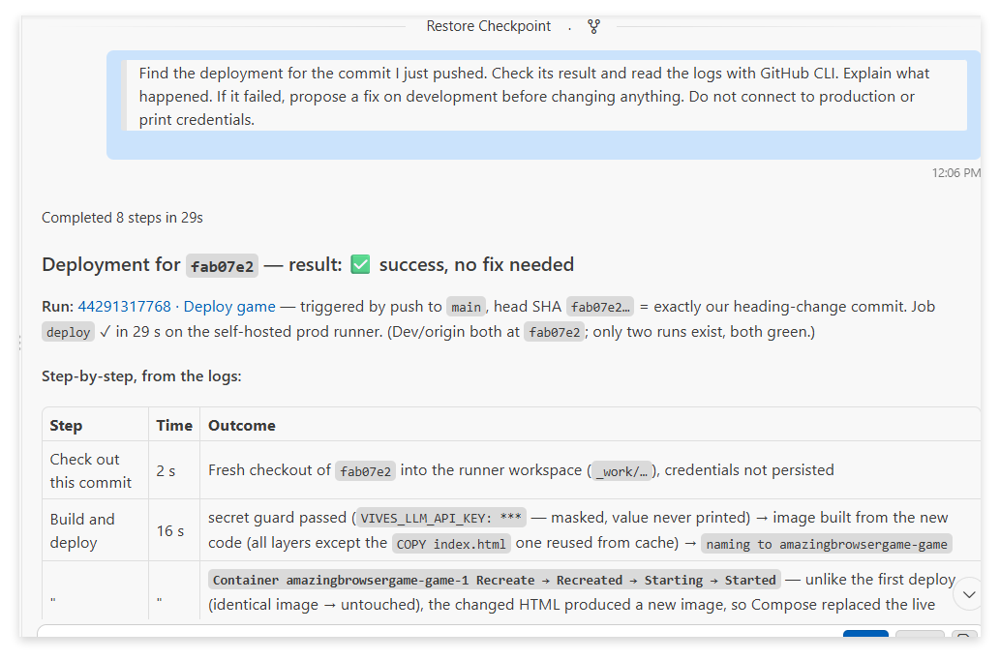
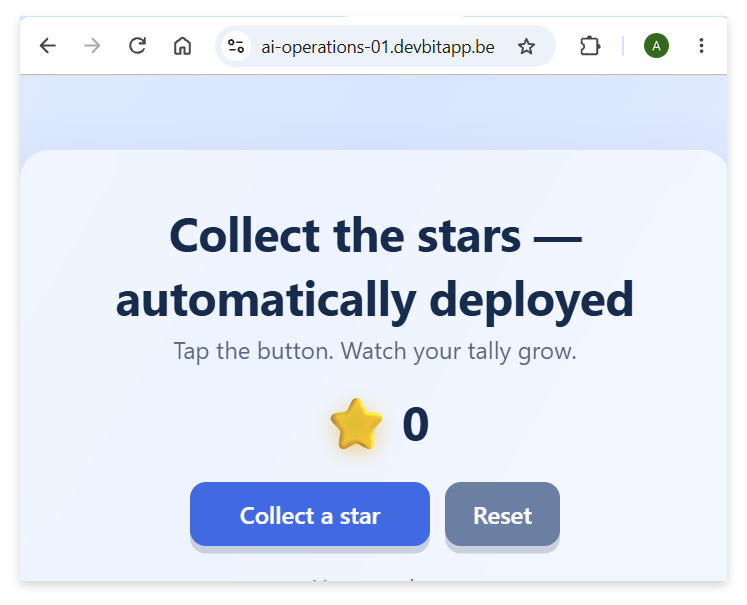

# 13 — Automate your deployment



In [Assignment 12](12-deploy-your-game.md), you deployed your game manually.
Now let **GitHub Actions** do that work whenever you push to `main`. You will
finish by publishing a visible change and watching it reach your public game.

Keep the working Dockerfiles, Compose configuration and production server.
Build images on that server during deployment. We do not need an image registry,
and a short interruption while containers are replaced is fine.

## From a push to a running game

**Continuous deployment (CD)** automatically deploys changes. **Continuous
integration (CI)** checks changes through tasks such as building and testing.
This assignment introduces deployment. Later, we will add tests and pull-request
requirements so bad changes do not go straight into production.

A **workflow** is a YAML file in `.github/workflows/`. An event, such as a push,
triggers it. It contains **jobs**, each made of **steps**. A **runner** is the
machine and agent software that execute those steps. Steps can run shell commands
or reusable actions, such as checking out a repository.

[](assets/13-deployment-workflow.svg)

We use a **self-hosted runner on your production LXC**, registered to your private
game repository. GitHub coordinates the job, but the build and Docker commands
run on your server. The runner connects outward to GitHub, so this does not
require a new public SSH port. Later tests will use GitHub-hosted runners.

Keep your coding agent on **development**. You perform the production setup
below in your own SSH terminal, with the agent helping explain commands when
needed. It can inspect deployment results through GitHub without production SSH.
However, permission to push code or edit workflows still gives it indirect control
over production. Review changes before approving a push, including documentation
or memory updates. Every push to `main` will trigger this deployment workflow.

## Prepare data and configuration for automation

The runner will check out code into its own workspace, separate from the clone
you used manually. Do not depend on files left in that workspace. It can be
recreated, and [actions/checkout](https://github.com/actions/checkout) normally
cleans untracked and ignored files, including a local `.env` or `./data` folder.
Even when the path stays the same, its contents are not permanent storage.

On **development**, review the deployment with your coding agent:

> Prepare our Compose deployment to run from a GitHub Actions runner's checkout.
> Explain where code, configuration and any persistent data belong. Keep our
> existing production data and Compose project identity. Identify any bind mounts
> that depend on the current repository path before changing anything.

Choose storage according to your game:

| Need | Suitable choice |
| --- | --- |
| Matches may reset and there is nothing to save | No persistent storage required. |
| Docker should manage saved application files | A named volume, such as `game-data:/app/data`. |
| You need a particular directory on the server | A bind mount with a stable absolute path outside the repository, such as `/srv/my-game/data:/app/data`. |

The paths are examples. Use your application's actual data directory. Named
volumes must also be declared in Compose's top-level `volumes` section. For a
bind mount, create the host directory and set permissions for the user inside
the application container. Neither choice automatically provides backups.
See Docker's [volumes](https://docs.docker.com/engine/storage/volumes/) and
[bind mounts](https://docs.docker.com/engine/storage/bind-mounts/) guides.

[](assets/13-code-config-data.svg)

Keep code and static game documentation in the image. If you already have saved
data in a repository-relative folder, plan its transfer with your agent before
switching mounts. A new empty volume does not import existing data automatically.

Also preserve the **Compose project name**, which groups its containers, networks
and volumes. On **production**, run `docker compose ls` and note the exact name
of your existing game. On **development**, set that exact name in the top-level
`name` field of `compose.yaml`, alongside `services`:

```yaml
name: amazingbrowsergame
```

Replace this example with your own existing project name. Commit it with your
deployment changes so manual deployments and the runner use the same name,
regardless of the checkout directory. Keep this ordinary configuration in Git.
Do not delete volumes or run `down -v` during deployment.

## Register a production runner

For this dedicated teaching LXC, run the runner as **root**, just like your
manual deployment. No separate Linux account is needed. This gives workflows
control over the whole LXC. Docker isolates the game containers, not the runner
that manages them. Keep the repository private and only execute trusted workflows
on this runner, not pull requests from untrusted contributors.

On **GitHub**, open your game repository's **Settings → Actions → Runners** and
click **New self-hosted runner**.

<a href="assets/13-new-self-hosted-runner.png"></a>

Select **Linux / x64** for the supplied production LXC. GitHub displays the
current download and registration commands. The registration command contains
a temporary token. Paste it only into your production terminal, never into chat,
screenshots or Git.

In your **production root SSH terminal**, start from root's home directory:

```bash
cd /root
```

Follow GitHub's **Download** commands in order. They create and enter
`actions-runner`, download the archive and extract it. Run the folder-creation
step only once. Before continuing, `pwd` should show `/root/actions-runner`,
where `config.sh` is now available.

Allow configuration as root in this terminal:

```bash
export RUNNER_ALLOW_RUNASROOT=1
```

Now run the **`./config.sh` registration command** from GitHub. Accept the default
runner group and work folder, and choose a recognizable runner name. At the
additional-labels prompt, press Enter to skip. We only need one runner for this
repository, so no custom labels are needed.

If configuration reports missing system libraries, follow its dependency
installation instructions as root, then retry the registration command. Your
agent can help interpret errors without seeing the token.

After registration, **skip GitHub's `./run.sh` command**. Install and start the
background service instead, still as root:

```bash
cd /root/actions-runner
./svc.sh install root
./svc.sh start
./svc.sh status
```

The service keeps the runner available after logout and starts it at boot.

<a href="assets/13-runner-online.png"></a>

Check that its status is **active (running)**. Then return to your repository's
**Settings → Actions → Runners** on GitHub. Find your runner and confirm it is
online and **Idle**, ready to accept a job. GitHub may display a green status
dot instead of the word Idle. Your runner name may differ from the screenshot.

If startup fails, start with `./svc.sh status`.
Additional runner diagnostics are in `_diag/`. Do not start another runner
manually alongside the service.

Installation details are in GitHub's [runner setup](https://docs.github.com/en/actions/how-tos/manage-runners/self-hosted-runners/add-runners)
and [service guide](https://docs.github.com/en/actions/how-tos/manage-runners/self-hosted-runners/configure-the-application).

## Supply deployment secrets

On **GitHub**, open **Settings → Secrets and variables → Actions**. In the
**Secrets** tab, add a repository secret named `VIVES_LLM_API_KEY`, using your
production key. Adapt this and the workflow below to your game's existing names.
Add any other required private settings the same way.

<a href="assets/13-repository-secret.png"></a>

The workflow passes secrets to the Compose process. Your existing Compose
`environment` mappings then pass the appropriate values to the application.
There is no need to copy `.env` into the runner workspace. Keep `.env.example`
as the list of required settings, and map every required setting in the workflow.
GitHub does not automatically turn all repository secrets into environment variables.

Never print secrets or the fully resolved Compose configuration in workflow logs.
GitHub masks registered secrets, but masking is not a reason to log them.
See [using secrets in GitHub Actions](https://docs.github.com/en/actions/how-tos/write-workflows/choose-what-workflows-do/use-secrets).

## Build your deployment workflow

On **development**, ask your coding agent to create
`.github/workflows/deploy.yml` using this starting point. Review and adapt it
to your game before committing:

```yaml
name: Deploy game

on:
  push:
    branches: [main]
  workflow_dispatch:

permissions:
  contents: read

concurrency:
  group: production-deployment
  cancel-in-progress: false

jobs:
  deploy:
    if: github.ref == 'refs/heads/main'
    runs-on: self-hosted
    timeout-minutes: 20
    steps:
      - name: Check out this commit
        uses: actions/checkout@v6
        with:
          persist-credentials: false

      - name: Build and deploy
        env:
          VIVES_LLM_API_KEY: ${{ secrets.VIVES_LLM_API_KEY }}
        run: |
          docker compose up -d --build --wait --wait-timeout 120
          docker compose ps
```

The push trigger runs on `main`. `workflow_dispatch` adds a manual **Run workflow**
button once the workflow is on the default branch. The job's `if` also prevents
a manual run on another branch from deploying. Checkout retrieves the commit
that triggered the run, using the job's GitHub token rather than your personal
token from Assignment 12. The workflow's `contents: read` permission is enough
for checkout. Do not add your personal GitHub token as a deployment secret.

`concurrency` prevents overlapping deployments without cancelling the active
deployment. If several pushes arrive, a newer pending run can replace an older
pending one. See GitHub's [concurrency guide](https://docs.github.com/en/actions/how-tos/write-workflows/choose-when-workflows-run/control-workflow-concurrency).

Compose builds before replacing the changed containers, preserving their mounted
data. `--wait` waits for services to be running, or healthy when they have health
checks, with a 120-second limit. That still does not prove gameplay works. See
the [Compose up reference](https://docs.docker.com/reference/cli/docker/compose/up/).

The example assumes `compose.yaml` is at the repository root. Have your agent
adjust the working directory, configuration and startup checks if your game
needs it. Preserve the port 8080 mapping and `restart: always` settings from 12.

## Follow your first deployment

<a href="assets/13-deployment-success.png"></a>

Commit and push the reviewed workflow to `main`. On **GitHub**:

1. Open your repository's **Actions** tab and select **Deploy game**.
2. Open the run for your pushed commit. Check its branch, commit and status.
3. Open the **deploy** job. Expand **Check out this commit** and **Build and deploy**
   to read the checkout, image build and Compose output, even when they succeed.

If the run remains queued, check the runner is online in this repository's settings.
If it fails, start with the first failing step rather than the final summary.

Open your public game URL and play. Confirm that the game still works and any
saved data is still present. Once Actions owns deployment, avoid also deploying
manually from the old production clone with potentially stale code.

If the image and service configuration are unchanged, Compose may keep the
existing container running. That is expected. The visible change below will
exercise deploying an updated image.

## Let your agent inspect the deployment

Your development agent can help through the GitHub CLI login from
[Assignment 04](04-put-your-game-on-github.md). That token's **Actions: Read and write**
permission includes reading runs and logs. **Workflows: Read and write** allows
pushing workflow changes. Do not copy the production token or create a broader
token for this task.

In your game's **development** terminal, list the runs:

```bash
gh run list --workflow deploy.yml --branch main --limit 5
```

Use the run ID from that list in `gh run view RUN_ID` to inspect its status.
After it finishes, use `gh run view RUN_ID --log` for the full log, or
`gh run view RUN_ID --log-failed` for failed steps. These commands show snapshots.
Use the browser for live progress. [`gh run watch`](https://cli.github.com/manual/gh_run_watch)
does not currently support our fine-grained tokens.

If `gh run view` reports a `403` specifically for **check annotations**, it may
still retrieve the run and workflow logs. Check those results separately. This
token limitation does not itself mean deployment failed, and does not require
a broader token.

> Find the deployment for the commit I just pushed. Check its result and read
> the logs with GitHub CLI. Explain what happened. If it failed, propose a fix
> on development before changing anything. Do not connect to production or
> print credentials.

<a href="assets/13-agent-deployment-review.png"></a>

These are **workflow logs**, not a continuous feed of your application's logs.
If deployment succeeds but gameplay fails, inspect the browser requests and,
when needed, read the application's Docker logs yourself on production.
See the [GitHub CLI run reference](https://cli.github.com/manual/gh_run_view).

## Publish a visible change

Now make a small, recognizable change on **development**, such as a heading or
button color. Try it, review it, commit and push to `main`. Follow the new run,
compare its commit with your push, then reload the public game and find the change.
You should not need to SSH into production to deploy it.

<a href="assets/13-public-game-updated.png"></a>

With your agent, document the workflow, required secret names and storage
choice in your project. Update the project memory. Be able to explain where the
job runs, where its configuration comes from and how you know the new version is
live. We now deploy automatically, but do not yet test automatically. That is
the next improvement.
