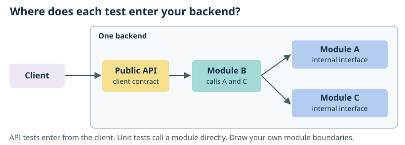

# 14 — Test your backend

In [Assignment 13](13-automate-your-deployment.md), a green deployment told you
that your game was running. Would it still be green if a player action changed
the wrong person's state? Probably. This time you will make the **whole backend**
easier to change and build a test suite that tells you when its behavior changes.

Work on a branch on **development** with your coding agent. A push to `main`
already deploys the game. Leave the production server and its data alone.
Keep your language and framework. You do not need a new container setup or an
Actions workflow for this assignment.

## Choose what each test should prove

Suppose a player sees the wrong state in the browser. The backend might have
calculated the wrong result, sent the right result to the wrong client, or sent
the right message to a frontend that never displayed it. Those are different
mistakes. You do not need to start a browser to find all three.

| Test | Where you enter the application | What you can learn |
| --- | --- | --- |
| Unit | Call one module through its own interface, without a server, network or external database. | Does it return, change or reject what its contract promises? Many cases can run quickly. |
| Integration | Exercise collaborating modules using their real implementations. | Do they agree on the meaning of the data they exchange? Does a write produce what the reader expects? |
| API | Send requests or messages to a running test backend, as a client would. | Do routing, rules and state together produce the promised response and effect? No browser needed. |
| Browser | Interact with the real frontend and observe what a user sees. | Does the control send the action and display the result correctly? **Optional** for this assignment. |

The [test pyramid](https://martinfowler.com/articles/practical-test-pyramid.html)
is a guide, not a required ratio. Put many cases close to the module that owns
the decision. Add broader tests for mistakes you cannot see there. Broader tests
usually need more setup, and a failure has more possible causes. Teams use
different names for these layers. An API test that runs the whole backend is
also a system test, even if it substitutes a predictable answer for an external
service. Say what actually ran.

## Map the backend before moving code

Start with a conversation, not a rewrite:

> Inspect our backend and the frontend code that calls it. List our public
> operations, who calls them and what each is supposed to do. Show me where
> those decisions live in the code today. Identify responsibilities that are
> mixed together and propose module boundaries. Point out ambiguous behavior
> for me to decide. Do not change files yet.

Compare the inventory with your game. Include the less visible operations,
such as chat and game tools where present. Decide what callers **should** be
able to rely on. Do not let the current implementation, or the agent that
wrote it, become the only authority on the expected result.

Before moving code, capture important existing behavior with API tests on
development. Give them their own backend instance and test state. This gives
you an outside view that should keep passing while the internals change.

Now refactor in small steps. Give each module a responsibility you can name
and an interface another module can use without knowing its internals. If
testing a rule requires constructing an HTTP request and connecting to the
model server, can you separate the decision from how the request arrived?
Keep boundaries that already work. A module might be a Python package, a
JavaScript module, or a set of related classes. One deployable backend is fine.
The letters in the diagram are not a directory layout to copy.

## Test each module and its collaborations

Choose a test runner that fits your existing code. For **each backend module**,
write unit tests through its interface. A useful test reads like three short
statements: **given** a known starting state, **when** I perform this action,
**then** I expect this observable result. Cover ordinary behavior and relevant
boundaries or rejections. For a rejection, what must remain unchanged?

Name tests after the promise they check. Prefer an assertion about the result
over an assertion that three private helpers ran in a particular order. That
way the test still protects you after the next refactor. Google’s
[note on testing behavior](https://testing.googleblog.com/2013/08/testing-on-toilet-test-behavior-not.html)
illustrates this distinction.

Keep unit tests quick and independent. For instance, pass a small stand-in for
an LLM client that returns a chosen reply or raises a timeout. You can then
exercise your application's handling of both outcomes without a key or a
network call. Do not replace the application logic you are trying to verify.

Look for interactions that unit tests miss. Where two real modules must agree
on a format, a state transition or an error, exercise them together in a focused
integration test. There is no benefit in duplicating every unit case at this
level. Choose a mistake that could survive both modules' unit tests.

## Test the complete public API

Return to your inventory. Cover **every public operation** through the actual
backend protocol, whether that means HTTP routes, WebSocket messages or another
interface. Do not call the handler directly and count it as a network test.
Assert what the client receives **and** what the operation promises to change.
A successful status or an open socket alone proves little.

For shared behavior, use separate clients where that distinction matters. Read
the state through the API after an action, or check which client received the
event and what it contained. Exercise relevant failure paths too. Compare the
tests with your inventory to spot operations that nobody has tested.

**Real software does not require production data.** A fresh instance of your
usual database, seeded with test records, is a real database. Never point
tests at the production database, game URL or saved files. Give tests a known
starting state and clean up after them, including after failure.

At this level you may use the real school inference service when the question
is whether your backend actually works with it. Use test inputs and supply the
key privately at runtime, never in Git, chat or logs. Check the promised
behavior, not an exact generated sentence. Keep live checks separately
selectable so a cluster outage does not prevent you from testing your own
logic. Document what is real, what is substituted and why.

## Make a change and leave the suite green

Pick one useful change to your own application. Agree on its intended effect
before asking the agent to implement it. Add or update the tests for that
effect. If an older test fails, decide whether the agreement really changed
or the code is wrong. Do not weaken an assertion just to make it pass.

Provide **one documented command** that runs the routine unit, integration
and API tests on development. It should prepare the isolated test backend,
wait until it is ready, run the checks and clean up. A failed assertion must
give the command a nonzero exit code. Run it twice: both runs should pass
without manual resets or reliance on a previous test's data. Finish with
working code and passing tests, not a broken commit for the next assignment.

## Explain your architecture

Put an **Architecture** section in your game's top-level README, or link from
there to a document in the repository. Include a **vector diagram** of your
actual backend. Use the real module names and label the arrows with what is
called or exchanged. A reader should be able to follow a frontend interaction
through the public API, into the responsible modules and back to the browser.

Alongside the diagram, explain each module's responsibility and interface.
Document the public operations, including requests or messages, responses and
relevant errors. Link to the tests that verify those contracts. Include the
local test command, any prerequisites and how to select live checks. Explain
how the frontend works even if you do not automate its tests.

Review the diff and the diagram against the code with your agent. Commit the
reviewed work to your project branch and update project memory. At the oral
defense, be ready to open any module or API operation and answer: **What does
it promise? Which test would catch a broken promise? What could still go wrong
even with that test passing?**

**Optional browser automation:** To cover a risk that remains on the frontend,
use a real browser to drive a user interaction and check the visible result.
The open-source [Playwright](https://github.com/microsoft/playwright) library
can run locally. Its [testing guide](https://playwright.dev/docs/best-practices)
shows how to select controls as a user would and keep browser sessions isolated.
You do not need to repeat the whole API suite through the UI.
