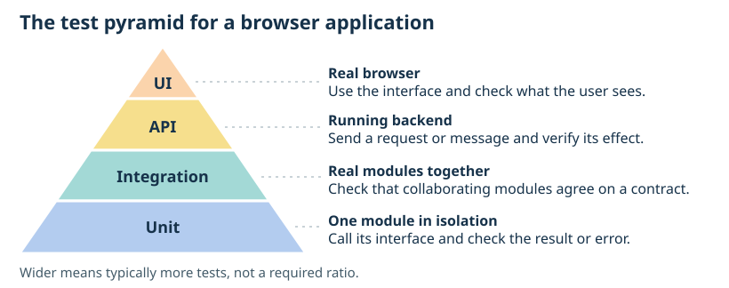
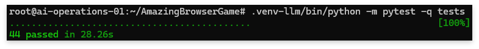
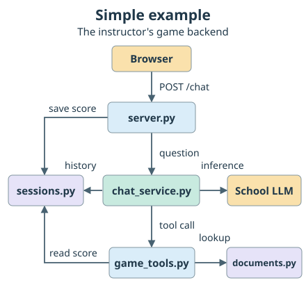

# 14 — Test your backend


In [Assignment 13](13-automate-your-deployment.md), a green deployment told you
that your game was running. It did not tell you whether a player action
changed the right person's state. In this assignment you will map your
**whole backend**, protect its existing behavior with tests and refactor it
into modules. Then you will use that suite to make a change to your own game.

## Start on a Git branch

Open **your game repository on your development server** in VS Code. The
server is where you work. A **Git branch** is where Git records your new
commits without moving `main`. That matters because pushing to `main` already
deploys your game.

In the game repository's terminal, run `git status`. If you have uncommitted
work, review it with your agent before switching branches. From a clean
working tree, run:

```bash
git switch main
git pull --ff-only
git switch -c assignment-14-backend-tests
git branch --show-current
```

This updates your local `main`, then `git switch -c` creates a branch from
that commit and switches to it. The last command should print
`assignment-14-backend-tests`. When resuming the assignment, use
`git switch assignment-14-backend-tests` without `-c` to return to the
existing branch. None of these commands pushes or deploys anything.

Keep your language and framework. All work stays on development, with
separate test data. No new containers or Actions workflow are needed.

## Understand the test pyramid



Suppose your backend is meant to reject an action and leave the game state
unchanged. You could open a browser and try every invalid input by hand. But
if the state changes, where is the mistake? Did the rule allow the action?
Did another module ignore the rejection? Or did the screen change even though
the server rejected the request? Each layer of the pyramid lets you ask a
different question about the same behavior.

**Unit tests: does this module make the right decision?** A unit is a piece of
code with one responsibility and an interface you can call. It need not be
one function or one class. In a unit test, call that interface directly with
a known input and assert the result you expect. For a rule with a limit, try
inputs below, at and above the limit. You can run all three cases without
starting the game, opening a database or calling an LLM. That makes these
tests fast, and a failure points you to a specific decision. It does not tell
you whether the rest of the backend uses that decision correctly.

**Integration tests: do the parts work together?** Now exercise the real
modules on both sides of an internal interface. For instance, call the code
that handles an action, let it consult the real rule, and read back the state
afterwards. The rule might correctly return a rejection while its caller
writes the proposed state anyway. Neither module's isolated tests necessarily
catch that disagreement. No HTTP server or browser is needed to test that
interaction. If the interaction you care about is with a database, use a
disposable test database so the real read and write code runs.

**API tests: does the running backend keep its promise to a client?** Start a
test instance and use the same public protocol as your frontend. Send an HTTP
request or a WebSocket message and inspect the reply or event. For a rejected
action, also read back the state through the API. A rejection message alone
does not prove that nothing changed. This crosses boundaries a direct module
call skips: the backend must decode the message, route it and deliver the
right result. It still tells you nothing about what the browser displays.

**Browser tests: does the user see the promised behavior?** Drive the real
page as a player would and assert something visible. Does a rejected action
leave the screen in the right state and explain what happened? This can catch
a frontend that treats an error response as success even when every backend
test passes. You will test the backend through its API in this assignment.
Automating the browser interaction is optional.

The [test pyramid](https://martinfowler.com/articles/practical-test-pyramid.html)
is wide at the base because lots of small tests can cover variations cheaply.
Higher up, more parts have to be started, coordinated and reset, and there
are more places to look when a test fails. Use fewer broad tests to cover
risks that the narrow ones miss. **The width is not a quota, and the names
are not universal.** An API test can be a *system test* of the whole backend.
“API” tells you where the test enters, not whether the database or LLM is
real. When explaining your suite, say what you called, what actually ran and
what failure the test would catch.

## Map the backend before moving code

Your goal is to **refactor your backend into modules you can test separately**.
Refactoring means changing how the code is organized while keeping the behavior
its callers rely on. A module groups code that has one clear responsibility and
offers an interface: the functions or methods other code can call without
knowing how the module does its work.

Think back to the rejected action in the pyramid. If the rule that decides
whether to accept an action is buried in a request handler, you may have to
start the server just to try the rule with a different input. Give that
decision its own interface and both the handler and a unit test can call it.
The unit test can now check the decision directly. An API test still checks
that the running backend acts on it. That is the benefit you are looking for,
not a larger number of files.


The diagram shows the distinction between the interface your frontend uses
and those inside the backend. The letters are not a layout to copy. To find
useful boundaries in **your** game, first map what the backend does today:

> Inspect our backend and the frontend code that calls it. List our public
> operations, who calls them and what each is supposed to do. Show me where
> those decisions live in the code today. Identify responsibilities that are
> mixed together and propose module boundaries. Point out ambiguous behavior
> for me to decide. Do not change files yet.

Review the inventory yourself. Distinguish what the frontend calls from what
the backend calls internally, such as tools made available to the model.
Decide what each caller **should** be able to rely on. An unexpected result
in today's code is something to discuss, not automatically something to
preserve in a test.

## Protect existing behavior before refactoring

A **test runner** is the program you start to find and run your tests. You
write the checks, called *assertions*, that say what should happen. If a check
fails, the runner tells you which test failed and where. This is different
from the GitHub Actions runner in Assignment 13: that runner executes a job
on a machine. A test runner can run right here in your development terminal.

If your project already has a test command, use it. Otherwise, choose **one**
tool for your backend. Here are three options:

| Backend | Test runner | Command from the project root |
| --- | --- | --- |
| Python | [pytest](https://docs.pytest.org/en/stable/how-to/usage.html) lets you write test functions with ordinary `assert` statements. Install it in your development environment. | `python -m pytest` |
| Python | [unittest](https://docs.python.org/3/library/unittest.html) comes with Python. Write test methods in a `TestCase` class. | `python -m unittest discover` |
| Node.js | The built-in [node:test](https://nodejs.org/api/test.html) runner can run JavaScript tests without an extra package. | `node --test` |

With your agent, turn an important operation from your inventory into an API
test. Start a separate backend instance on a free local port with known test
data. Send a request or message and check the outcome you agreed on. Run it
against the **unchanged** backend and make sure the runner lists the test by
name when you use its detailed output.

Capture the other behaviors you most need to preserve before moving code.
This is your starting suite, not the final API coverage. These tests use the
client's interface, so they should still pass when you reorganize the
implementation behind it.

## Test each module and its collaborations

Use your map to refactor one responsibility at a time. Keep boundaries that
already work. A module might be a Python package, a JavaScript module or a
set of related classes. Your backend can still run as a single application.
After each change, rerun the starting suite to check that callers still see
the same behavior.

For **each backend module**, write unit tests through its interface. A useful
test reads like three short statements: **given** a known starting state,
**when** I perform this action,
**then** I expect this observable result. Cover ordinary behavior and relevant
boundaries or rejections. For a rejection, what must remain unchanged?

Name tests after the promise they check. Prefer an assertion about the result
over an assertion that three private helpers ran in a particular order. That
way the test still protects you after the next refactor. Google’s
[note on testing behavior](https://testing.googleblog.com/2013/08/testing-on-toilet-test-behavior-not.html)
illustrates this distinction.

### When should you replace a dependency?

How would you test what your chat tells a player when the model times out?
Waiting for the school cluster to fail is hardly a repeatable test. Instead,
keep your chat code real and pass it a **test double** in place of the
function that contacts the model. In the running game you pass the real
function. In a test you choose what happens when the chat calls it.

```python
from unittest.mock import Mock

def answer(message, ask_model):
    if not message.strip():
        return "Enter a message."
    try:
        return ask_model(message)
    except TimeoutError:
        return "Please try again."

def test_timeout_gives_the_player_a_retry_message():
    slow_model = Mock(side_effect=TimeoutError())
    assert answer("How do I play?", slow_model) == "Please try again."

def test_blank_message_never_reaches_the_model():
    model = Mock()
    assert answer(" ", model) == "Enter a message."
    model.assert_not_called()
```

The first double acts as a **stub**: it supplies a chosen outcome, here a
timeout, and the test checks the result of the real `answer` function. The
second acts as a **mock**: the test also checks an interaction. Even if the
player sees the right message, contacting the model for blank input would
still waste a request. Python's [Mock](https://docs.python.org/3/library/unittest.mock.html)
can serve either role. Use the equivalent in your own language.

Neither test proves that the real client can talk to the school cluster.
Likewise, replacing one of your own modules with a stub tells you nothing
about whether the two real modules agree. Where they share a data format,
state transition or error that could be misunderstood, add an integration
test that exercises them together. You do not need to repeat every unit case.

## Test the complete public API

Return to your inventory and extend the starting suite to cover **every
public operation**. Use the same HTTP routes, WebSocket messages or other
protocol your frontend uses. Calling a handler directly skips this boundary.
Assert what the client receives **and** what the operation promises to change.
A successful status or an open socket alone proves little.

For shared behavior, use separate clients where that distinction matters. Read
the state through the API after an action, or check which client received the
event and what it contained. Exercise relevant failure paths too.

**Real software does not require production data.** A fresh instance of your
usual database, seeded with test records, is a real database. Never point
tests at the production database, game URL or saved files. Give tests a known
starting state and clean up after them, including after failure.

At this level you may use the real school inference service when the question
is whether your backend actually works with it. Use test inputs and supply the
key privately at runtime, never in Git, chat or logs. Check the promised
behavior, not an exact generated sentence. Keep live checks separately
selectable so a cluster outage does not prevent you from testing your own
logic. Document what is real, what is substituted and why.

## Optional: test through the browser

Your API tests now act as clients, but none of them clicks a button. A
browser test closes that gap: it drives the real frontend and checks what
the player sees. **Browser automation is optional for this course.** For a
production web application, we strongly recommend it for critical user
interactions that could break even with a green backend suite.

To try it, pick one interaction from your own game that you normally check
by hand. Write down the starting state, what the player does and what they
should see afterwards. Then ask your agent to automate those steps:

1. Start your local test game with known test data and open it in a fresh
   browser session. Use your development test URL, not the public game.
2. Perform the interaction through the page. Find a control by its visible
   label or its role and name rather than by a CSS class that might change
   when you restyle it.
3. Assert the visible outcome you predicted. Wait for that outcome rather
   than sleeping for a fixed time. A successful click or HTTP response is
   not enough if the player still sees the old state.

[Playwright](https://github.com/microsoft/playwright) is an open-source tool
that can drive a real browser locally, even without a desktop window. Its
[testing guide](https://playwright.dev/docs/best-practices) shows how to find
controls and use assertions that retry while the page updates.

## Make a change and leave the suite green

Pick one useful change to your own application. Agree on its intended effect
before asking the agent to implement it. Add or update the tests for that
effect. If an older test fails, decide whether the agreement really changed
or the code is wrong. Do not weaken an assertion just to make it pass.

Provide **one documented command** that runs the routine unit, integration
and API tests on development. It should prepare the isolated test backend,
wait until it is ready, run the checks and clean up. A failed assertion must
give the command a nonzero exit code. Run it twice: both runs should pass
without manual resets or reliance on a previous test's data. Finish with
working code and passing tests, not a broken commit for the next assignment.

<a href="assets/14-pytest-green.png"></a>

The instructor's game finished with `44 passed`. Your game will have its own
set of tests.

## Explain your architecture

<a href="assets/14-example-backend.svg"></a>

Put an **Architecture** section in your game's top-level README, or link from
there to a document in the repository. Include a **vector diagram** of your
actual backend. Use the real module names and label the arrows with what is
called or exchanged. A reader should be able to follow a frontend interaction
through the public API, into the responsible modules and back to the browser.

In the simple example on the right, follow the two arrows out of
`game_tools.py`: a question about the player's score needs session state,
while a question about the rules needs the document catalog. That distinction
explains why those modules are separate. Draw the boundaries that make sense
for **your** application, not the ones in the example.

Alongside the diagram, explain each module's responsibility and interface.
Document the public operations, including requests or messages, responses and
relevant errors. Link to the tests that verify those contracts. Include the
local test command, any prerequisites and how to select live checks. Explain
how the frontend works even if you do not automate its tests.

Review the diff and check the diagram against the code with your agent.
Update project memory and commit the reviewed work to your project branch.

At the oral defense, use your diagram to explain **how your backend fits
together and how you know it works**. Describe what the main modules are
responsible for and how they work together. Use an example from your test
suite to explain what you checked at the module level and what you verified
through the API. The focus is on your design and testing choices, not on
remembering implementation details.
