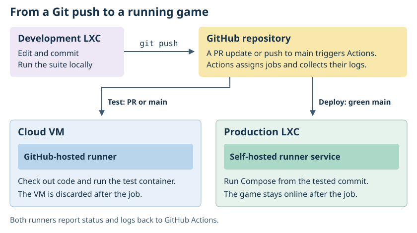
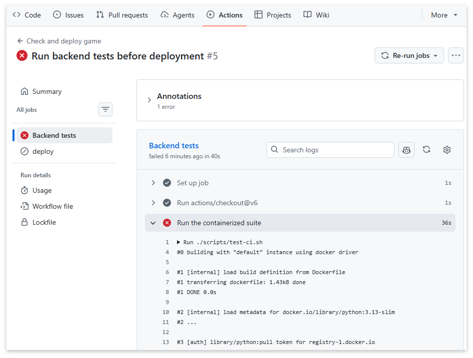
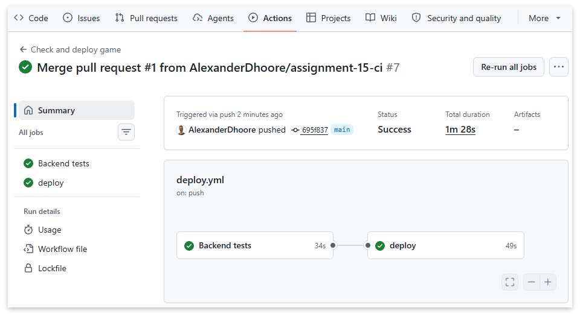

# 15 — Continuous integration: test every pull request


In this assignment you will set up **continuous integration (CI)** for your
game. You will use GitHub Actions to run your tests from Assignment 14 on
every pull request, so you can see whether a change works before you merge
it. You will then connect those tests to your deployment from Assignment 13:
only a passing commit on `main` should reach your players.

## What does CI/CD mean for your game?

**Continuous integration (CI)** means bringing changes into the shared codebase
frequently and checking automatically that they work together. In your game,
a **pull request (PR)** proposes merging your branch into `main`. Each time
you update that PR, GitHub will run your backend tests against the proposed
merge. You get feedback while you can still change the code. A green PR does
not change the game your players see.

**Continuous deployment (CD)** takes the next step: changes that reach
`main` and pass its checks go to production without a separate release
decision. In Assignment 13 a push to `main` already deployed your game.
Now the merged commit must pass the tests first. If they fail, players keep
using the previous version.

You may also see CD used for **continuous delivery**. With delivery, the
tested version is ready to release, but the team chooses when to release it.
Here CD means *deployment*: after a successful check on `main`, nobody needs
to click a deploy button.

## Start with your passing suite

Work on **development**, in the game repository. Start from the branch that
contains your completed [Assignment 14](14-test-your-backend.md) tests. If that
work is already on `main`, start from an up-to-date `main`. Otherwise start
from your assignment 14 branch. There is no need to deploy it first.

Check `git status`, make sure your work is committed, and run the documented
test command from your README. Once it passes, create your work branch:

```bash
git switch -c assignment-15-ci
```

Keep this first result for comparison. If the same tests fail inside a
container, look for a difference in the environment before changing a test.

## Package the tests, not a second game

A GitHub-hosted runner won't have your local virtual environment, installed
packages or ignored files. A **test image** describes what a fresh machine
needs to run your suite. It contains your code, tests, runtime and test
dependencies. Starting a container from it should run the same suite you
just ran on development, print the results and exit.

For many games, **one container is enough**. If your fixture from 14 starts
the backend, let it keep doing that. The API client and server can talk over
`localhost` inside the test container without publishing a port on your LXC.
You don't need a second copy of the game running under Compose.

> Inspect our Dockerfile, the test command in our README and how our API tests
> start the backend. Package that suite so I can run it with one command on a
> clean machine with Docker. Keep test-only tools out of the production image
> and do not copy credentials, local environments or saved game data into
> the build. Explain whether our tests actually need a separate service.

A separate `Dockerfile.test` is a simple option. Reuse your application's
build steps where useful. If you already use a [multi-stage Dockerfile](https://docs.docker.com/build/building/multi-stage/),
a named test stage works too. Build that stage explicitly with
`docker build --target test -t game-tests .`. Without a target, Docker
builds the **last stage**. Keep production last or select its target in
your deployment Compose file, so production starts the game, not the tests.
For the single-container option, a small executable script
named `scripts/test-ci.sh` could look like this:

```sh
#!/bin/sh
set -eu
docker build -f Dockerfile.test -t game-tests .
docker run --rm game-tests
```

Here the image's default command runs the tests. A failed build stops the
script. A failed test must give the container, and therefore the script, a
nonzero **exit code**. That number is how GitHub will know the check failed.
Look at the runner's summary too. A command that never discovers your API
tests isn't the suite you meant to package.

**If you need a separate service**, such as PostgreSQL, use a test-only
Compose project instead. Start a disposable database, wait until it is
ready, and let the test container connect by its Compose service name, not
`localhost`. Sharing the database *process* is fine. Sharing a previous
test's game state is not. Give each test isolated records or reset the data
between tests. Have the script return the test service's exit code and clean
up the test project even on failure. Never point cleanup at the game's
deployment project or volumes. Docker documents [service networking](https://docs.docker.com/compose/how-tos/networking/)
and the Compose [`--exit-code-from` option](https://docs.docker.com/reference/cli/docker/compose/up/).

From the repository root, run `chmod +x scripts/test-ci.sh`, then
`./scripts/test-ci.sh`. Run it a second time. Both runs should find the
expected tests and pass without a manual reset. Commit the script with its
executable permission. This is the command GitHub will run too.

## Where does each job run?

When you push a branch from your development LXC and open a PR on GitHub,
your code is on GitHub, but your tests haven't run just because you did a
`git push`. **GitHub Actions coordinates the work. A runner executes it.**
The `runs-on` line in each job decides where its checkout and shell commands run.

[](assets/15-pr-to-production.svg)

- **Test on GitHub's machine** (`runs-on: ubuntu-latest`). GitHub provides
  a fresh Ubuntu VM for the job. It checks out the code, builds your test
  image and runs the suite there. You read the result and logs on GitHub.
  The VM is discarded afterwards. You don't install a runner on development
  and the tests don't need a connection to your live game.
- **Deploy on your machine** (`runs-on: self-hosted`). This is the runner
  service you installed **inside the production LXC** in
  [Assignment 13](13-automate-your-deployment.md), not another VM. It connects
  out to GitHub to receive jobs. After the `main` commit passes its tests,
  this runner checks out that same commit and runs Docker Compose locally.
  The live game stays on the LXC after the job ends.

There is no image transfer or SSH connection from the cloud runner to
production. What passes between the jobs is **a result**, not a container.
A green PR ends at the check. Merging triggers a new run on `main`, and only
that tested revision can be deployed. GitHub documents the two runner types:
[GitHub-hosted](https://docs.github.com/en/actions/concepts/runners/github-hosted-runners)
and [self-hosted](https://docs.github.com/en/actions/concepts/runners/self-hosted-runners).

## Connect the suite to your existing workflow

Adapt **the existing** `.github/workflows/deploy.yml` on your work branch.
Do not leave the old workflow deploying every push independently of the new
test job. This is the shape for the game from 13. Keep your own deploy steps,
working directory and secret names:

```yaml
name: Check and deploy game

on:
  pull_request:
    branches: [main]
  push:
    branches: [main]
  workflow_dispatch:

permissions:
  contents: read

concurrency:
  group: game-workflow-${{ github.ref }}
  cancel-in-progress: false

jobs:
  test:
    name: Backend tests
    runs-on: ubuntu-latest
    timeout-minutes: 20
    steps:
      - uses: actions/checkout@v6
        with:
          persist-credentials: false
      - name: Run the containerized suite
        run: ./scripts/test-ci.sh

  deploy:
    needs: test
    if: github.event_name != 'pull_request' && github.ref == 'refs/heads/main'
    runs-on: self-hosted
    timeout-minutes: 20
    steps:
      - uses: actions/checkout@v6
        with:
          persist-credentials: false
      - name: Build and deploy
        env:
          VIVES_LLM_API_KEY: ${{ secrets.VIVES_LLM_API_KEY }}
        run: |
          docker compose up -d --build --wait --wait-timeout 120
          docker compose ps
```

Two lines make the difference. **`needs: test`** means deployment is skipped
if the test job fails. The **`if`** keeps deployment off PRs even when tests
pass. A push to `main` tests the resulting commit, not yesterday's green PR.
A manual run on `main` also goes through the tests. Both jobs check out the
revision for that run. The concurrency group keeps main runs from deploying
over one another without making unrelated PRs wait for production. See
GitHub's [job dependencies](https://docs.github.com/en/actions/how-tos/write-workflows/choose-what-workflows-do/use-jobs)
and [pull request events](https://docs.github.com/en/actions/reference/workflows-and-actions/events-that-trigger-workflows#pull_request).

The ordinary PR suite must work **without production access or secrets**.
Keep live inference checks separately selectable as in 14. Run them on
development or in a separate trusted job with a test key from Actions Secrets,
injected only at runtime. Never put the key in the image, logs or PR workflow.
Review workflow changes before pushing: they decide what can run on your LXC.

## Open a green pull request

Review and commit your changes, then run `git push -u origin assignment-15-ci`.
On GitHub, open **Pull requests → New pull request**. Choose `main` as the
base and your work branch as the compare branch. If assignment 14 isn't
on `main` yet, the diff will also include its refactor and tests. That is
expected: this PR will integrate both. Review the diff and create the PR.
**Leave it open.**

Open the PR's **Checks** tab, choose **Backend tests** and expand **Run the
containerized suite**. Find the test summary you saw locally. In the Actions
run, confirm that **deploy** was skipped. Green here means the proposed
change passed, not that anyone's public game changed. If a build or test
fails on this first run, fix the setup on your branch until you have that
green baseline.

## See what a red check tells you

Pick a behavior that a test from 14 already protects. On the **same branch**,
change the implementation so its result no longer matches that expectation.
For example, change how a boundary value is handled. Leave the test alone.
Commit and push to the work branch. GitHub updates the open PR automatically.

Open **Backend tests → Run the containerized suite**. In the example below,
checkout passed, the test step failed and the deploy job was skipped.

<a href="assets/15-pr-test-failure.png"></a>

The red icon tells you **which step** failed, not **why**. Scroll past the
build output and find the **test name, expected outcome and actual outcome**.
In this run, the test expected `'hi'` but received `' hi '`: the backend
had stopped trimming chat input. Look for the equivalent evidence in your run.
Your development agent can also read the log. On your work branch, list its PR runs:

```bash
gh run list --event pull_request --branch "$(git branch --show-current)" --limit 5
```

Take the ID of the failed run and use `gh run view RUN_ID --log-failed`.
This reads the Actions log directly, without production SSH or extra
permissions to read PR check annotations.

**Can you still click Merge?** A red check reports a problem. A *required*
check can also stop a merge. Where your plan supports it, open **Settings →
Branches**, add a classic branch protection rule for `main`, require a
pull request and require **Backend tests** as a status check. For a solo
project, leave required approving reviews off. To enforce it for yourself as
repository admin, select **Do not allow bypassing the above settings**.
Return to the red PR and inspect the merge status without merging it.
[GitHub's setup guide](https://docs.github.com/en/repositories/configuring-branches-and-merges-in-your-repository/managing-protected-branches/managing-a-branch-protection-rule)
explains the settings.

For a private personal repository, GitHub Free does not include branch
protection. The [Student Developer Pack](https://education.github.com/pack)
offers GitHub Pro to verified students. For an organization repository, the
organization's plan applies. **Don't pay or make your game public for this
assignment.** Without enforcement the rule for this course is the same:
merge only when the tests pass.

Now decide what is correct. If the change broke a promise, fix the code.
If you deliberately changed the promise, update the test to check the new
behavior. Don't just delete the assertion. Run the suite, commit and push
the correction. Find the passing check on **the same PR**.

## Merge and follow the checked commit

On your work branch, document the local container test command in your game
README. Update project memory with the workflow and a link to the PR that
went red and green. Push those changes to the PR too.

Before merging, check that the latest PR run is green and your diff contains
only the changes you intend to release. Merge your game PR. Open **Actions**
and find the new **push** run on `main`, not the earlier PR run. Compare the
run's commit with the latest commit on `main`. In the job graph, follow
**Backend tests → deploy**.

<a href="assets/15-main-tested-and-deployed.png"></a>

Notice the `main` badge beside the commit and the line connecting the two
green jobs. Unlike the earlier green PR, **this run deployed the game**.
Open your public URL and verify the game works.

This is the final assignment. Keep the PR, its test logs and the main run
handy for your project demonstration: together they show which fault your
suite caught, how you fixed it and which version reached your players.
