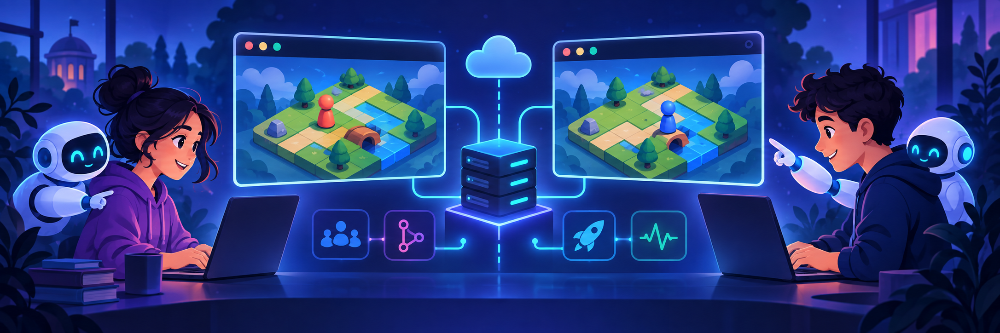

# AI Operations

> **Course slogan:** You have to understand what you're building.

In this course, you will design, build, and operate a browser-based multiplayer
game. The same game runs through all 15 assignments. At first, AI is a tool
you use to build the game. Later, it becomes part of the game: players can
ask an assistant about the rules and the state of play. By the final
assignment, you can take a change from your development server through a
tested pull request to a running game your classmates can join.

You choose the game and the technologies. There is no prescribed frontend,
backend, language, or framework. Research your options, explain your choices,
and keep the scope small enough that you can make the game work end to end. By
the end of the course, people should be able to join the same game from
separate browsers and affect a shared game state.

## What you are responsible for

An AI assistant can generate code and suggest commands, but you are the
engineer responsible for the result. Be able to explain the application's
architecture as a whole. Use your diagram to show what runs in the browser,
what runs on the server, where game state lives, and how the AI assistant
uses game data. Explain why you drew the module boundaries where you did
and how your tests verify that the parts work together. You do not need
to memorize every line of code.

At the end of the semester, you will demonstrate your live game and defend
your work in a conversation with the instructor. We should be able to inspect
the running system, examine the code and its development workflow, and make a
new deployment. The central question is the same as on day one: **do you
understand what you built?**

## Assignments

### Build a prototype and move development to Linux

- [01 — Start building with VS Code Chat](01-start-building-with-ai.md)
- [02 — Add web search to your AI assistant](02-add-web-search.md)
- [03 — Develop on a remote Linux server](03-develop-on-a-remote-server.md)
- [04 — Put your game on GitHub](04-put-your-game-on-github.md)

### Work with coding agents

- [05 — Give your agent a memory](05-give-your-agent-a-memory.md)
- [06 — Teach your agent a skill](06-teach-your-agent-a-skill.md)
- [07 — Work with Pi in a persistent terminal](07-work-with-pi-and-screen.md)
- [08 — Delegate work to coding agents](08-delegate-work-to-agents.md)

### Put an AI assistant inside the game

- [09 — Add an AI chat to your game](09-add-an-ai-chat-to-your-game.md)
- [10 — Give your game assistant tools](10-give-your-game-assistant-tools.md)
- [11 — Give your assistant document lookup](11-let-your-game-assistant-look-up-documents.md)

### Deploy the game and test each change

- [12 — Deploy your game](12-deploy-your-game.md)
- [13 — CD: Automate your deployment](13-automate-your-deployment.md)
- [14 — Test your backend](14-test-your-backend.md)
- [15 — CI: Test every pull request](15-test-every-pull-request.md)

Assignment 15 is the final assignment. Use the remaining project time to
finish your game and practise your demonstration. Be ready to defend the
architecture of your whole game, from how its components fit together to
how you test and deploy the system.
